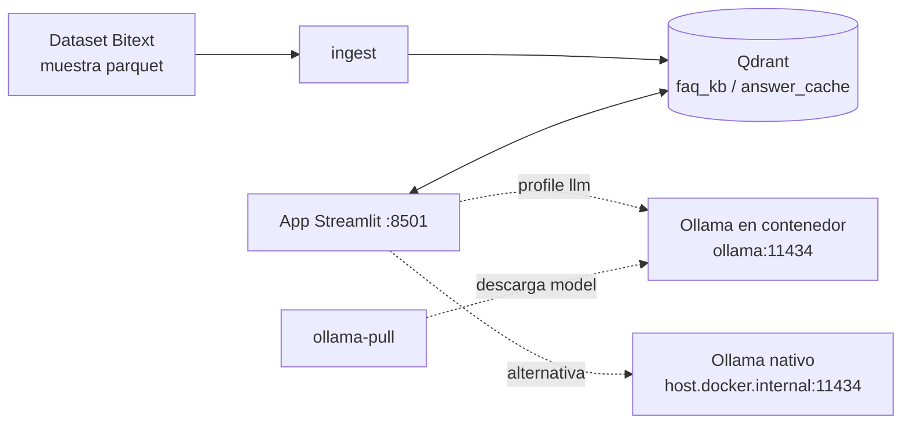

# Qdrant Lab

Laboratorio didáctico de búsqueda vectorial con Qdrant: búsqueda semántica, filtros, búsqueda híbrida, recomendaciones, un asistente de soporte con caché semántica y un inspector de la base. Todo corre en Docker.

## Requisitos
- Docker Desktop (única dependencia obligatoria; Windows, macOS o Linux).
- Opcional, para la pestaña 5 con LLM local (dos caminos, ver "LLM local con Ollama"):
  - Ollama en contenedor con `--profile llm` (no instalas nada más).
  - Ollama nativo en el equipo anfitrión ([ollama.com](https://ollama.com)).

## Arranque en 3 comandos
```bash
git clone <URL-DEL-REPOSITORIO> qdrant-lab && cd qdrant-lab
cp .env.example .env        # en Windows (cmd): copy .env.example .env
docker compose up
```
La primera vez se construye la imagen (descarga los modelos de embeddings) y se ingestan las FAQs (menos de 1 minuto para 3,000). Cuando termine, abre http://localhost:8501. El dashboard de Qdrant está en http://localhost:6333/dashboard (usa la API key de `.env`).

Para detener: `Ctrl+C` y `docker compose down` (añade `-v` para borrar los datos).

## Arquitectura


## LLM local con Ollama
Sin Ollama la pestaña 5 muestra solo el benchmark grabado.

**Camino A: contenedor (recomendado).** Con `OLLAMA_URL=http://ollama:11434` en `.env`:
```bash
docker compose --profile llm up
```
Levanta `ollama` y `ollama-pull`, que descarga `OLLAMA_MODEL` (por defecto `llama3.2:3b`, unos 2 GB; `qwen2.5:14b` pesa unos 9 GB). El modelo queda en el volumen `ollama_data`, así que solo se descarga una vez. En Docker Desktop para Mac el contenedor usa CPU (sin GPU de Apple), por lo que las respuestas son más lentas.

**Nota:** el contenedor `ollama` no publica puerto en el host. El comando `ollama` de la terminal del host habla con el Ollama nativo, no con el contenedor; para el contenedor usa `docker compose exec ollama ollama ...` (por ejemplo `list`).

**Camino B: Ollama nativo.** Instala Ollama, ejecuta `ollama pull llama3.2:3b` y en `.env` pon `OLLAMA_URL=http://host.docker.internal:11434`. Arranca con `docker compose up` (sin profile); en Mac usa la GPU.

## Configuración
Todo se controla desde `.env` (copia de `.env.example`). Si cambias `DENSE_MODEL`, edita también el `Dockerfile` (los modelos se descargan al construir la imagen) y reconstruye con `docker compose build`.

## Guion de demo (4 minutos)
| Min | Pestaña | Qué hacer | Número a señalar |
|---|---|---|---|
| 0:00 | Arranque | Mostrar que `docker compose up` ingesta las FAQs. | Ingesta de 3,000 FAQs en menos de 1 minuto. |
| 0:30 | 1. Semántica | Consultar "quiero que me devuelvan el dinero de mi compra". El denso encuentra "I would like to obtain my money back"; la palabra exacta no devuelve nada. | Similitud coseno de 0.807 vs. 0 resultados. |
| 1:15 | 2. Filtros | Elegir `category`/`intent` y comparar con y sin filtro. | Elegir una `category`: de los 5 resultados "Sin filtro", contar cuántos son de otras categorías, frente a 0 "Con filtro"; comparar también los ms de ambas columnas. |
| 1:45 | 3. Híbrida | Consultar "refund order 12345". Ver IDs que aparecen en una sola columna y la fusión RRF. | Denso y BM25 no comparten ningún ID; la columna híbrida (RRF) mezcla resultados de ambas. No recites IDs: BM25 tiene empates (score 5.4983) y Qdrant puede ordenarlos distinto entre corridas. |
| 2:15 | 4. Recomendaciones | Elegir ejemplos positivos y negativos y una estrategia. | El score de similitud del primer resultado; los ejemplos elegidos no se repiten (0 resultados repetidos). |
| 2:45 | 5. Soporte | Antes de exponer pulsa **Vaciar caché**. Consulta "¿Cómo cambio mi dirección de envío?" (caché: fallo) y luego "¿Cómo puedo cambiar mi dirección de envío?" (caché: acierto, 0 tokens). | En vivo cada consulta varía; las cifras sólidas son las del benchmark grabado (llama3.2:3b, Ollama nativo en GPU M4 Max, 200 corridas), tal como salen en pantalla: tokens medios 768 vs 4,210 (ahorro 81.8 %; totales 76,760 vs 421,047), caché en paráfrasis 32 / 50 con 0 tokens, categoría correcta 82 % vs 54 %, latencia media 2.2 s vs 3.9 s. El par "¿Cómo cancelo mi pedido?" / "Quiero cancelar mi orden, ¿cómo lo hago?" da coseno 0.8946 y no pasa el umbral 0.92 (`CACHE_THRESHOLD`). Los textos `{{Customer Support Hours}}` son marcadores del propio dataset Bitext. |
| 3:30 | 6. Inspector | Ver HNSW y cuantización int8; pulsar el botón de la API key. | Memoria estimada ~4 veces menor con int8; Qdrant responde 401 sin API key y 200 con ella. |

## Pruebas
```bash
docker compose run --rm app pytest
```
El CI (`.github/workflows/ci.yml`) ejecuta lo mismo en cada push.

## Solución de problemas
- **El puerto 6333 u 8501 está ocupado:** cierra el proceso que lo usa o cambia el mapeo en `docker-compose.yml`.
- **`app` no arranca:** espera a que `ingest` termine; revisa `docker compose logs ingest`.
- **401/403 desde Qdrant:** la clave se lee de `.env` al arrancar (`QDRANT__SERVICE__API_KEY`) y no se guarda en el volumen. Revisa `QDRANT_API_KEY` en `.env` y aplica el cambio con `docker compose up -d --force-recreate`.
- **La pestaña 5 dice que Ollama no está disponible:** arranca con `docker compose --profile llm up` (comprueba `OLLAMA_URL=http://ollama:11434` y que `ollama-pull` terminó con `docker compose --profile llm ps -a`), o inicia Ollama nativo y usa `OLLAMA_URL=http://host.docker.internal:11434`; confirma el modelo con `ollama list`. En Linux se usa `host.docker.internal` gracias a `extra_hosts`. Sin Ollama se muestran solo los gráficos del benchmark grabado.
- **`ollama-pull` tarda mucho:** la primera vez descarga ~2 GB; con red lenta espera a que termine, el progreso se conserva en el volumen.
- **`docker compose --profile llm up` se queda esperando:** es la descarga de llama3.2:3b (2 GB); con red lenta (330–690 KB/s en la certificación) `app` espera a que `ollama-pull` termine. Mira el avance con `docker compose logs -f ollama-pull`. Alternativa: levanta sin profile (la pestaña 5 muestra el benchmark) o usa Ollama nativo.
- **La caché acierta a la primera:** quedan respuestas de sesiones anteriores en `answer_cache`. Pulsa **Vaciar caché** en la pestaña 5 (solo borra la caché; `faq_kb` no se toca).
- **Calentar el modelo:** la primera consulta a Ollama carga el modelo en memoria y tarda más; haz una consulta de prueba antes de exponer y luego vacía la caché.
- **Build lento:** la primera construcción descarga los modelos; las siguientes usan caché.
- **Windows:** usa `copy .env.example .env` y ejecuta los comandos desde PowerShell o cmd con Docker Desktop iniciado.

## Licencia del dataset
Las FAQs provienen del dataset *Bitext Customer Support LLM Chatbot Training Dataset* (Bitext), publicado bajo licencia CDLA-Sharing-1.0. Consulta la página del dataset en Hugging Face para los términos vigentes.
