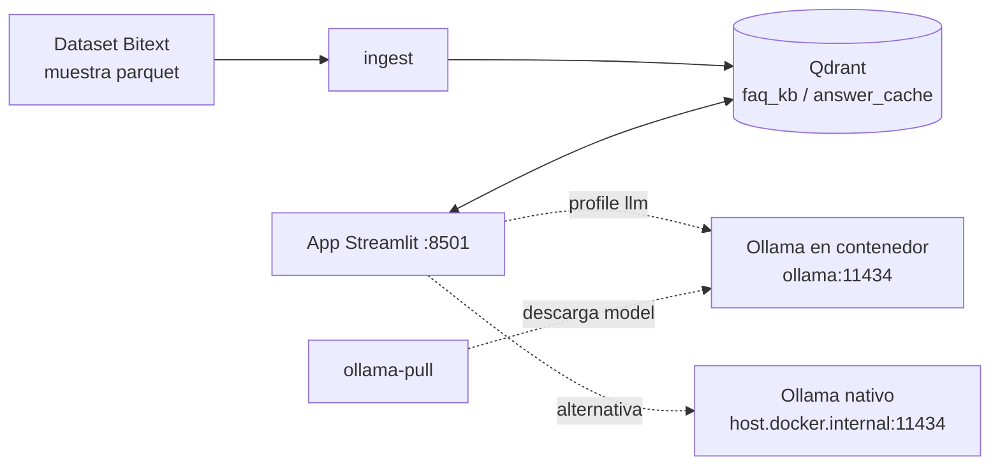

# Qdrant Lab

Laboratorio didáctico de búsqueda vectorial con Qdrant: búsqueda semántica, filtros, búsqueda híbrida, recomendaciones, un asistente de soporte con caché semántica y un inspector de la base. Todo corre en Docker.

## Requisitos
- Docker Desktop (única dependencia obligatoria; Windows, macOS o Linux).
- Opcional, para la pestaña 5 con LLM local (dos caminos, ver "LLM local con Ollama"):
  - Ollama en contenedor con `--profile llm` (no instalas nada más).
  - Ollama nativo en el equipo anfitrión ([ollama.com](https://ollama.com)).

## Arranque en 3 comandos
```bash
git clone <URL-DEL-REPOSITORIO> qdrant-lab && cd qdrant-lab
cp .env.example .env        # en Windows (cmd): copy .env.example .env
docker compose up
```
La primera vez se construye la imagen (descarga los modelos de embeddings) y se ingestan las FAQs (menos de 1 minuto para 3,000). Cuando termine, abre http://localhost:8501. El dashboard de Qdrant está en http://localhost:6333/dashboard (usa la API key de `.env`).

Para detener: `Ctrl+C` y `docker compose down` (añade `-v` para borrar los datos).

## Arquitectura


## LLM local con Ollama
Sin Ollama la pestaña 5 muestra solo el benchmark grabado.

**Camino A: contenedor (recomendado).** Con `OLLAMA_URL=http://ollama:11434` en `.env`:
```bash
docker compose --profile llm up
```
Levanta `ollama` y `ollama-pull`, que descarga `OLLAMA_MODEL` (por defecto `llama3.2:3b`, unos 2 GB; `qwen2.5:14b` pesa unos 9 GB). El modelo queda en el volumen `ollama_data`, así que solo se descarga una vez. En Docker Desktop para Mac el contenedor usa CPU (sin GPU de Apple), por lo que las respuestas son más lentas.

**Nota:** el contenedor `ollama` no publica puerto en el host. El comando `ollama` de la terminal del host habla con el Ollama nativo, no con el contenedor; para el contenedor usa `docker compose exec ollama ollama ...` (por ejemplo `list`).

**Camino B: Ollama nativo.** Instala Ollama, ejecuta `ollama pull llama3.2:3b` y en `.env` pon `OLLAMA_URL=http://host.docker.internal:11434`. Arranca con `docker compose up` (sin profile); en Mac usa la GPU.

## Configuración
Todo se controla desde `.env` (copia de `.env.example`). Si cambias `DENSE_MODEL`, edita también el `Dockerfile` (los modelos se descargan al construir la imagen) y reconstruye con `docker compose build`.

## Guion de demo (4 minutos)
Va de menos a más: cada paso responde la duda que deja el anterior. El stack ya está levantado, el modelo calentado y la caché vaciada (ver la lista "Antes de exponer").

| Min | Pregunta que responde | Pestaña | Qué hacer | Número a señalar |
|---|---|---|---|---|
| 0:00 | ¿Qué guarda Qdrant? | 6. Inspector + dashboard | Mostrar `faq_kb` y abrir un punto en el dashboard. | 3,000 puntos; cada uno con id, vector denso de 384 dimensiones, vector BM25 y payload (`instruction`, `response`, `category`, `intent`). |
| 0:20 | ¿Puede buscar por significado? | 1. Semántica | Consultar "quiero que me devuelvan el dinero de mi compra". | Coseno 0.807 con "I would like to obtain my money back" (español contra inglés) vs 0 resultados por palabra exacta. |
| 1:00 | ¿Y si solo quiero una categoría? | 2. Filtros | Elegir una `category` y comparar con y sin filtro. | Precisión, no velocidad: con filtro 0 resultados de otras categorías; los ms de ambas columnas son parecidos. |
| 1:25 | ¿Y cuando la palabra exacta importa? | 3. Híbrida | Consultar "refund order 12345". | Denso y BM25 no comparten ningún ID; la híbrida (RRF) mezcla ambos. No recitar IDs: BM25 tiene empates y su orden puede variar. |
| 1:55 | ¿Y si no tengo una consulta? | 4. Recomendaciones | Elegir positivos y un negativo; cambiar de `average_vector` a `best_score`. | Los ejemplos elegidos no se repiten; la estrategia cambia los resultados. |
| 2:25 | ¿Para qué sirve todo esto? | 5. Soporte | Dos consultas: "¿Cómo cambio mi dirección de envío?" (caché: fallo) y "¿Cómo puedo cambiar mi dirección de envío?" (caché: acierto). Luego el benchmark. | En vivo: 0 tokens en la paráfrasis (coseno 0.9836) y la categoría que adivina el modo sin Qdrant. Benchmark (200 corridas): 768 vs 4,210 tokens medios (81.8 %), caché 32 / 50, categoría 82 % vs 54 %, 2.2 s vs 3.9 s. |
| 3:40 | ¿Está listo para producción? | 6. Inspector | Pulsar "Probar API key"; señalar la cuantización. | 401 sin clave y 200 con clave; memoria int8 ~4 veces menor (4.4 MB vs 1.1 MB). |
| 4:00 | Cierre | | Una frase: multitenencia, snapshots y clúster existen en Qdrant pero quedan fuera del MVP. | |

Cuidados en la pestaña 5:
- No prometas velocidad en vivo. Una consulta suelta varía (en un ensayo, sin Qdrant tardó menos porque contestó "no tengo información"); la latencia se cuenta con el benchmark.
- Usa a tu favor las respuestas malas del modo sin Qdrant: si clasifica mal la categoría, eso es el 82 % vs 54 % en directo.
- Las dos consultas suman unos 26 s de espera del LLM (medido en el ensayo: 12 s y 14 s).

### Preguntas probables del público
| Pregunta | Respuesta |
|---|---|
| ¿Se puede escribir en vivo? | Sí: la caché semántica es eso. La primera consulta guarda su respuesta con `upsert` y la paráfrasis la encuentra segundos después. |
| ¿Qué pasa con una pregunta fuera de dominio? | La búsqueda siempre devuelve el vecino más cercano, pero con score bajo: "¿qué tiempo hace hoy?" da 0.32 y "¿quién ganó el mundial?" 0.35, frente a 0.807 de una pregunta del dominio. Por eso la caché usa un umbral (0.92). |
| ¿Los datos se pierden al reiniciar? | No: Qdrant guarda en un volumen de Docker. En el ensayo, la caché conservó 60 respuestas de sesiones anteriores tras reiniciar. |
| ¿Y si el LLM se cae? | La pestaña 5 muestra solo el benchmark grabado; el resto de la demo no depende del LLM. |
| ¿Escala? | Qdrant tiene multitenencia, snapshots y modo clúster; están fuera de este MVP. |

## Pruebas
```bash
docker compose run --rm app pytest
```
El CI (`.github/workflows/ci.yml`) ejecuta lo mismo en cada push.

## Solución de problemas
- **El puerto 6333 u 8501 está ocupado:** cierra el proceso que lo usa o cambia el mapeo en `docker-compose.yml`.
- **`app` no arranca:** espera a que `ingest` termine; revisa `docker compose logs ingest`.
- **401/403 desde Qdrant:** la clave se lee de `.env` al arrancar (`QDRANT__SERVICE__API_KEY`) y no se guarda en el volumen. Revisa `QDRANT_API_KEY` en `.env` y aplica el cambio con `docker compose up -d --force-recreate`.
- **La pestaña 5 dice que Ollama no está disponible:** arranca con `docker compose --profile llm up` (comprueba `OLLAMA_URL=http://ollama:11434` y que `ollama-pull` terminó con `docker compose --profile llm ps -a`), o inicia Ollama nativo y usa `OLLAMA_URL=http://host.docker.internal:11434`; confirma el modelo con `ollama list`. En Linux se usa `host.docker.internal` gracias a `extra_hosts`. Sin Ollama se muestran solo los gráficos del benchmark grabado.
- **`ollama-pull` tarda mucho:** la primera vez descarga ~2 GB; con red lenta espera a que termine, el progreso se conserva en el volumen.
- **`docker compose --profile llm up` se queda esperando:** es la descarga de llama3.2:3b (2 GB); con red lenta (330–690 KB/s en la certificación) `app` espera a que `ollama-pull` termine. Mira el avance con `docker compose logs -f ollama-pull`. Alternativa: levanta sin profile (la pestaña 5 muestra el benchmark) o usa Ollama nativo.
- **La caché acierta a la primera:** quedan respuestas de sesiones anteriores en `answer_cache`. Pulsa **Vaciar caché** en la pestaña 5 (solo borra la caché; `faq_kb` no se toca).
- **Antes de exponer:** levanta el stack, entra al dashboard con la API key y deja abierto un punto de `faq_kb`, haz una consulta de prueba en la pestaña 5 (carga el modelo) y pulsa **Vaciar caché**.
- **Calentar el modelo:** la primera consulta a Ollama carga el modelo en memoria y tarda más; haz una consulta de prueba antes de exponer y luego vacía la caché.
- **Build lento:** la primera construcción descarga los modelos; las siguientes usan caché.
- **Windows:** usa `copy .env.example .env` y ejecuta los comandos desde PowerShell o cmd con Docker Desktop iniciado.

## Licencia del dataset
Las FAQs provienen del dataset *Bitext Customer Support LLM Chatbot Training Dataset* (Bitext), publicado bajo licencia CDLA-Sharing-1.0. Consulta la página del dataset en Hugging Face para los términos vigentes.
